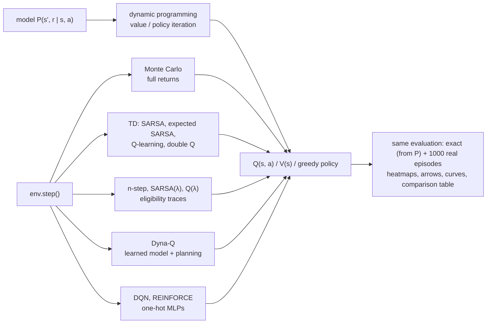
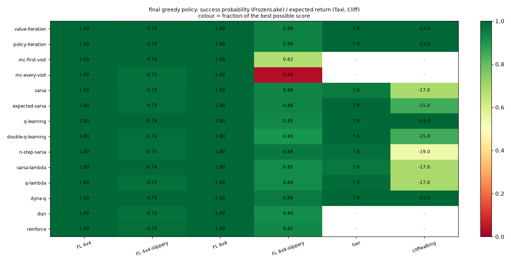
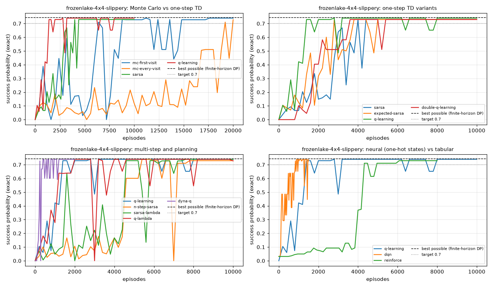
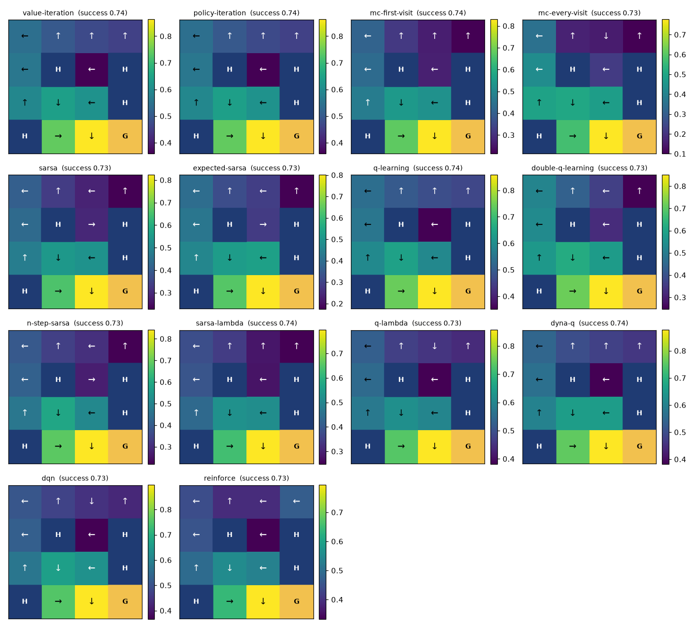
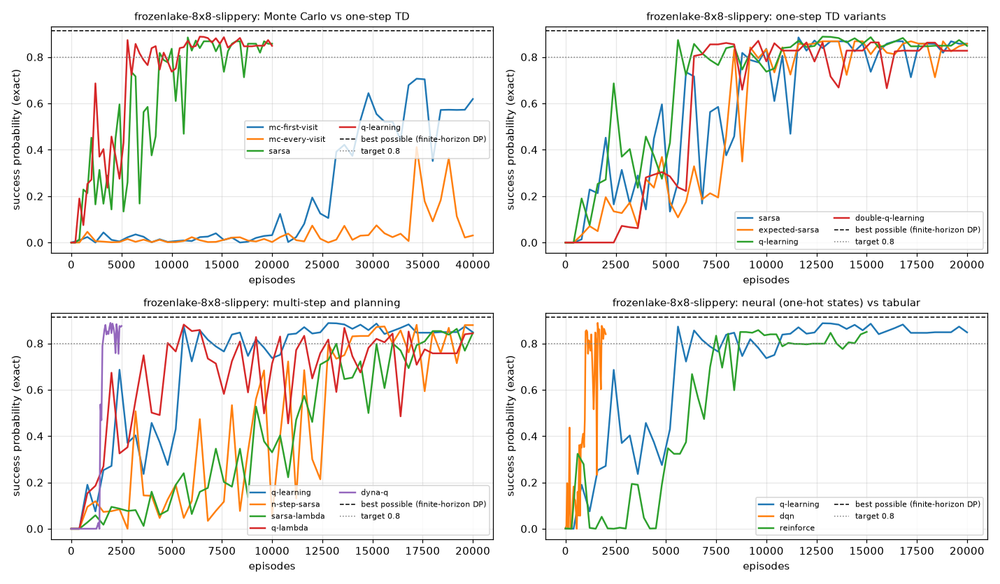
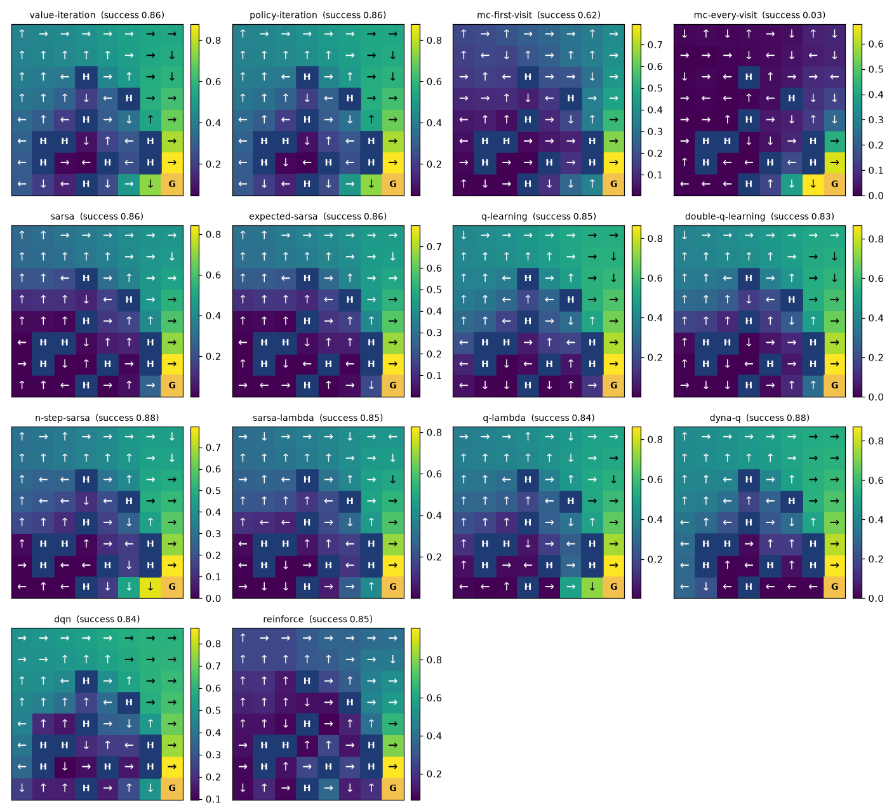
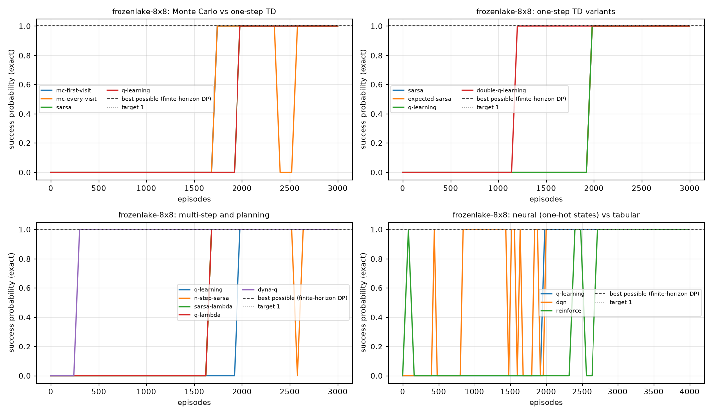
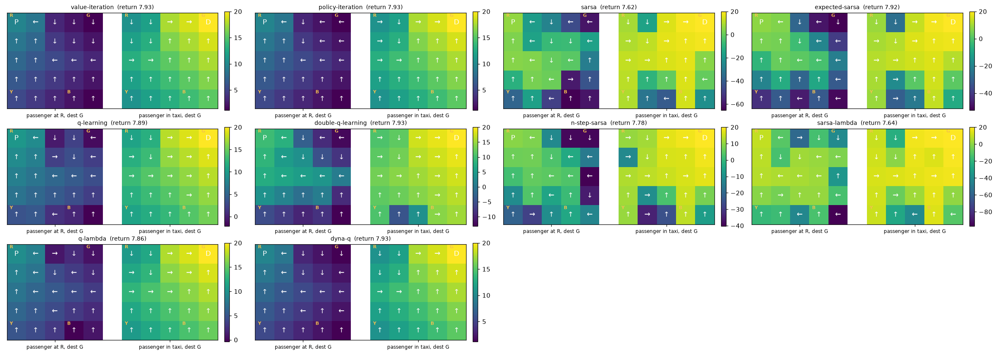
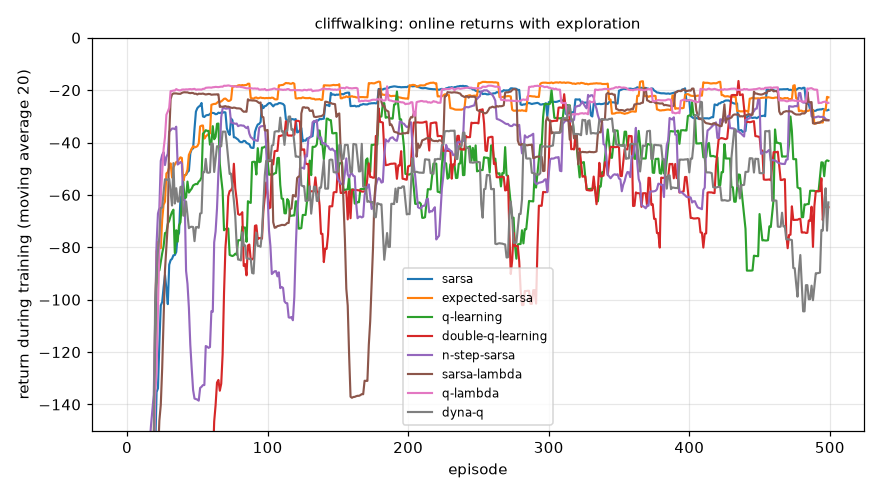
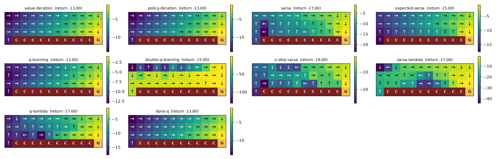

# frozenlake-rl

**FrozenLake, Taxi and CliffWalking solved with every classical reinforcement-learning method,
in one small readable code base: value and policy iteration, first-visit and every-visit Monte
Carlo control, SARSA, expected SARSA, Q-learning, double Q-learning, n-step SARSA, SARSA(lambda)
and Q(lambda) with eligibility traces, Dyna-Q, and DQN and REINFORCE on one-hot states. Every
method uses the same exploration, the same evaluation (exact from the model, and real episodes),
the same heatmaps, policy arrows and learning curves, so they can be compared side by side on a
CPU in minutes.**

[](LICENSE)
[](pyproject.toml)
[](https://pytorch.org)
[](https://gymnasium.farama.org)
[](docs/testing.md)

This is the tabular / dynamic-programming companion of my other RL repositories (CartPole,
LunarLander, MountainCar, Pendulum, Pong): the problems here are small enough that the exact
optimum is known, so every method can be checked against it instead of against a guess.



| method | `--method` | how it works, in one line | code |
|---|---|---|---|
| value iteration | `value-iteration` | sweep the Bellman optimality backup over all states with the true model | `algorithms/dp.py` `value_iteration` |
| policy iteration | `policy-iteration` | evaluate the policy exactly, improve it greedily, repeat until stable | `algorithms/dp.py` `policy_iteration` |
| first-visit MC | `mc-first-visit` | play an episode, move Q towards the return that followed the first visit of each (s, a) | `algorithms/monte_carlo.py` `mc_control` |
| every-visit MC | `mc-every-visit` | same, every visit counts (`--exploring-starts` for random starts) | `algorithms/monte_carlo.py` `mc_control` |
| SARSA | `sarsa` | on-policy TD: target r + γ Q(s', a') with the action actually taken next | `algorithms/td.py` `sarsa` |
| expected SARSA | `expected-sarsa` | target r + γ Σ π(a'\|s') Q(s', a'): SARSA without the sampling noise | `algorithms/td.py` `expected_sarsa` |
| Q-learning | `q-learning` | off-policy TD: target r + γ max Q(s', ·) | `algorithms/td.py` `q_learning` |
| double Q-learning | `double-q-learning` | two tables, one picks the argmax, the other evaluates it: no max bias | `algorithms/td.py` `double_q_learning` |
| n-step SARSA | `n-step-sarsa` | n real rewards, then bootstrap (`--n`, default 4) | `algorithms/td.py` `n_step_sarsa` |
| SARSA(λ) | `sarsa-lambda` | every TD error updates all recently visited pairs through decaying traces | `algorithms/td.py` `sarsa_lambda` |
| Q(λ) | `q-lambda` | Watkins: off-policy traces, cut after an exploratory action | `algorithms/td.py` `q_lambda` |
| Dyna-Q | `dyna-q` | Q-learning + a learned count model replayed 10 times per real step | `algorithms/planning.py` `dyna_q` |
| DQN | `dqn` | MLP Q-network, replay buffer, target network, on one-hot states | `algorithms/neural.py` `dqn` |
| REINFORCE | `reinforce` | policy gradient with a learned value baseline, 10 episodes per update | `algorithms/neural.py` `reinforce` |

Environments (`--env`): `frozenlake-4x4`, `frozenlake-4x4-slippery`, `frozenlake-8x8`,
`frozenlake-8x8-slippery`, `taxi`, `cliffwalking` ([docs/environment.md](docs/environment.md)).

## Quick start

```bash
git clone https://github.com/benisalla/frozenlake-rl && cd frozenlake-rl
uv venv .venv && VIRTUAL_ENV=.venv uv pip install -e ".[dev]"     # or: pip install -e ".[dev]"
source .venv/bin/activate

frozenlake-train --env frozenlake-4x4-slippery --method q-learning     # ~15 s, writes runs/<env>/<method>/
frozenlake-eval runs/frozenlake-4x4-slippery/q-learning --episodes 1000
frozenlake-play runs/frozenlake-4x4-slippery/q-learning --episodes 2   # watch it in the terminal
frozenlake-compare --env frozenlake-4x4 --methods all                  # every method, one table, ~1 min
pytest -q                                                              # 40 tests, ~45 s
```

Every method runs with the same command and tuned defaults; change `--method` and `--env`. Every
hyperparameter is a flag (`--alpha`, `--alpha-end`, `--epsilon-end`, `--n`, `--lam`,
`--planning-steps`, `--exploring-starts`, `--episodes`, ...), see [docs/training.md](docs/training.md).

## Examples

[`examples/`](examples/README.md) holds six scripts that use the package from Python, in the
order the methods build on each other: dynamic programming on the slippery lake, SARSA vs
Q-learning on the cliff, Monte Carlo vs TD, n-step / traces / Dyna-Q on the 8x8 lake, DQN and
REINFORCE, and the full comparison. Each one is a single command and runs on a CPU in seconds to
about a minute.

```bash
python examples/01_value_iteration.py && python examples/02_sarsa_vs_q_learning_cliff.py
```

## Results

These are **short CPU runs** (one thread, one seed, the default budgets of
[docs/training.md](docs/training.md)): their purpose is to show that every method learns and how
they differ, not to be benchmarks. All six suites together took 12 minutes
(`python scripts/compare_all.py`). "exact" is the success probability (or expected return) of the
final greedy policy computed from the model with the time limit; "rollout" is 1 000 real
gymnasium episodes with that policy; "episodes to target" is the first evaluation point (every
1 % of the run) at which the exact score reached the target. "best possible" is the ceiling of the
metric within the time limit, from finite-horizon dynamic programming.



### FrozenLake 4x4, slippery (ceiling 0.744)

| method | family | episodes | env steps | episodes to success >= 0.7 | exact success (greedy) | rollout success | rollout mean return | train time |
|---|---|---|---|---|---|---|---|---|
| `value-iteration` | DP | model | - | 0 (12 sweeps) | 0.740 | 0.729 | 0.73 | 0.2 s |
| `policy-iteration` | DP | model | - | 0 (4 sweeps) | 0.740 | 0.729 | 0.73 | 0.0 s |
| `mc-first-visit` | MC | 20,000 | 451,466 | 6,400 | 0.740 | 0.729 | 0.73 | 7.8 s |
| `mc-every-visit` | MC | 20,000 | 254,744 | 19,200 | 0.728 | 0.724 | 0.72 | 4.4 s |
| `sarsa` | TD | 10,000 | 240,232 | 4,000 | 0.730 | 0.728 | 0.73 | 4.4 s |
| `expected-sarsa` | TD | 10,000 | 239,497 | 2,800 | 0.730 | 0.728 | 0.73 | 7.3 s |
| `q-learning` | TD | 10,000 | 258,598 | 1,400 | 0.740 | 0.729 | 0.73 | 5.5 s |
| `double-q-learning` | TD | 10,000 | 238,703 | 3,600 | 0.730 | 0.726 | 0.73 | 3.9 s |
| `n-step-sarsa` | TD | 10,000 | 222,946 | 5,400 | 0.730 | 0.728 | 0.73 | 5.1 s |
| `sarsa-lambda` | TD | 10,000 | 232,770 | 4,600 | 0.740 | 0.729 | 0.73 | 5.7 s |
| `q-lambda` | TD | 10,000 | 265,673 | 2,000 | 0.728 | 0.724 | 0.72 | 6.6 s |
| `dyna-q` | planning | 2,000 | 51,351 | 240 | 0.740 | 0.729 | 0.73 | 10.6 s |
| `dqn` | neural | 1,500 | 36,754 | 840 | 0.728 | 0.724 | 0.72 | 8.7 s |
| `reinforce` | neural | 8,000 | 173,369 | 4,320 | 0.730 | 0.726 | 0.73 | 5.7 s |

best possible success within the time limit (finite-horizon DP): 0.744

Every method reaches the optimum (0.73 to 0.74; the 0.01 gap is a near-tie between two actions in
one state). What differs is the cost: DP needs no episodes, Dyna-Q 240 episodes, Q-learning
1 400, on-policy SARSA-type methods 3 000 to 5 000, first-visit MC 6 400 and every-visit MC
19 200. REINFORCE gets there too once it averages 10 episodes per update.




### FrozenLake 8x8, slippery (ceiling 0.913)

| method | family | episodes | env steps | episodes to success >= 0.8 | exact success (greedy) | rollout success | rollout mean return | train time |
|---|---|---|---|---|---|---|---|---|
| `value-iteration` | DP | model | - | 0 (39 sweeps) | 0.863 | 0.874 | 0.87 | 0.8 s |
| `policy-iteration` | DP | model | - | 0 (8 sweeps) | 0.863 | 0.874 | 0.87 | 0.0 s |
| `mc-first-visit` | MC | 40,000 | 1,972,555 | not reached | 0.619 | 0.620 | 0.62 | 49.2 s |
| `mc-every-visit` | MC | 40,000 | 1,448,913 | not reached | 0.031 | 0.043 | 0.04 | 40.9 s |
| `sarsa` | TD | 20,000 | 1,331,978 | 8,800 | 0.857 | 0.863 | 0.86 | 17.3 s |
| `expected-sarsa` | TD | 20,000 | 1,320,833 | 8,400 | 0.857 | 0.865 | 0.86 | 39.8 s |
| `q-learning` | TD | 20,000 | 1,284,219 | 5,600 | 0.848 | 0.870 | 0.87 | 21.5 s |
| `double-q-learning` | TD | 20,000 | 1,231,597 | 6,400 | 0.827 | 0.847 | 0.85 | 22.7 s |
| `n-step-sarsa` | TD | 20,000 | 1,327,470 | 14,000 | 0.879 | 0.904 | 0.90 | 47.7 s |
| `sarsa-lambda` | TD | 20,000 | 1,231,090 | 16,000 | 0.845 | 0.855 | 0.85 | 26.6 s |
| `q-lambda` | TD | 20,000 | 1,312,515 | 4,800 | 0.844 | 0.842 | 0.84 | 55.5 s |
| `dyna-q` | planning | 2,500 | 131,500 | 1,600 | 0.875 | 0.893 | 0.89 | 39.7 s |
| `dqn` | neural | 2,000 | 133,205 | 1,000 | 0.841 | 0.850 | 0.85 | 69.3 s |
| `reinforce` | neural | 15,000 | 911,061 | 7,500 | 0.850 | 0.869 | 0.87 | 41.2 s |

best possible success within the time limit (finite-horizon DP): 0.913

The hardest problem here: 64 states, a reward 14+ steps away, slips everywhere. TD, Dyna-Q, DQN and
REINFORCE all end between 0.83 and 0.88, close to the value-iteration policy (0.863, which
optimises the gamma = 0.99 discounted return rather than the success rate itself, so learned
policies can land slightly above it). **Monte Carlo is the clear loser**: full-episode returns
over 50 to 200 slippery steps are so noisy that first-visit MC stops at 0.62 after 40 000
episodes, and every-visit MC, which updates looping pairs many times per episode with the same
noisy return, does not learn a usable policy (0.03).




### FrozenLake 4x4 and 8x8, not slippery (ceiling 1.0)

4x4:

| method | family | episodes | env steps | episodes to success >= 1 | exact success (greedy) | rollout success | rollout mean return | train time |
|---|---|---|---|---|---|---|---|---|
| `value-iteration` | DP | model | - | 0 (6 sweeps) | 1.000 | 1.000 | 1.00 | 0.0 s |
| `policy-iteration` | DP | model | - | 0 (6 sweeps) | 1.000 | 1.000 | 1.00 | 0.0 s |
| `mc-first-visit` | MC | 1,000 | 8,658 | 40 | 1.000 | 1.000 | 1.00 | 0.2 s |
| `mc-every-visit` | MC | 1,000 | 7,827 | 40 | 1.000 | 1.000 | 1.00 | 0.2 s |
| `sarsa` | TD | 1,000 | 8,182 | 160 | 1.000 | 1.000 | 1.00 | 0.2 s |
| `expected-sarsa` | TD | 1,000 | 6,848 | 80 | 1.000 | 1.000 | 1.00 | 0.3 s |
| `q-learning` | TD | 1,000 | 7,055 | 80 | 1.000 | 1.000 | 1.00 | 0.2 s |
| `double-q-learning` | TD | 1,000 | 6,692 | 260 | 1.000 | 1.000 | 1.00 | 0.2 s |
| `n-step-sarsa` | TD | 1,000 | 8,368 | 140 | 1.000 | 1.000 | 1.00 | 0.2 s |
| `sarsa-lambda` | TD | 1,000 | 7,745 | 40 | 1.000 | 1.000 | 1.00 | 0.2 s |
| `q-lambda` | TD | 1,000 | 6,922 | 40 | 1.000 | 1.000 | 1.00 | 0.2 s |
| `dyna-q` | planning | 1,000 | 6,443 | 40 | 1.000 | 1.000 | 1.00 | 1.4 s |
| `dqn` | neural | 1,000 | 8,906 | 260 | 1.000 | 1.000 | 1.00 | 4.3 s |
| `reinforce` | neural | 1,000 | 7,009 | 380 | 1.000 | 1.000 | 1.00 | 0.5 s |

best possible success within the time limit (finite-horizon DP): 1.000

8x8:

| method | family | episodes | env steps | episodes to success >= 1 | exact success (greedy) | rollout success | rollout mean return | train time |
|---|---|---|---|---|---|---|---|---|
| `value-iteration` | DP | model | - | 0 (14 sweeps) | 1.000 | 1.000 | 1.00 | 0.0 s |
| `policy-iteration` | DP | model | - | 0 (14 sweeps) | 1.000 | 1.000 | 1.00 | 0.0 s |
| `mc-first-visit` | MC | 3,000 | 78,514 | 1,740 | 1.000 | 1.000 | 1.00 | 1.8 s |
| `mc-every-visit` | MC | 3,000 | 105,934 | 1,740 | 1.000 | 1.000 | 1.00 | 2.3 s |
| `sarsa` | TD | 3,000 | 80,374 | 1,980 | 1.000 | 1.000 | 1.00 | 2.0 s |
| `expected-sarsa` | TD | 3,000 | 78,163 | 1,980 | 1.000 | 1.000 | 1.00 | 3.3 s |
| `q-learning` | TD | 3,000 | 80,339 | 1,980 | 1.000 | 1.000 | 1.00 | 2.1 s |
| `double-q-learning` | TD | 3,000 | 63,818 | 1,200 | 1.000 | 1.000 | 1.00 | 1.0 s |
| `n-step-sarsa` | TD | 3,000 | 76,636 | 1,680 | 1.000 | 1.000 | 1.00 | 1.5 s |
| `sarsa-lambda` | TD | 3,000 | 75,464 | 1,680 | 1.000 | 1.000 | 1.00 | 1.7 s |
| `q-lambda` | TD | 3,000 | 75,118 | 1,680 | 1.000 | 1.000 | 1.00 | 1.7 s |
| `dyna-q` | planning | 3,000 | 52,060 | 300 | 1.000 | 1.000 | 1.00 | 8.6 s |
| `dqn` | neural | 2,000 | 55,455 | 440 | 1.000 | 1.000 | 1.00 | 19.9 s |
| `reinforce` | neural | 4,000 | 101,479 | 80 | 1.000 | 1.000 | 1.00 | 4.2 s |

best possible success within the time limit (finite-horizon DP): 1.000

Deterministic lakes are only an exploration problem: once the goal is found, everything converges.
Traces and n-step returns (1 640 to 1 680 episodes on the 8x8 lake) beat one-step TD (1 980),
and Dyna-Q needs 300.



### Taxi (500 states, ceiling 7.93)

| method | family | episodes | env steps | episodes to return >= 7 | exact return (greedy) | rollout success | rollout mean return | train time |
|---|---|---|---|---|---|---|---|---|
| `value-iteration` | DP | model | - | 0 (18 sweeps) | 7.93 | 1.000 | 7.91 | 0.7 s |
| `policy-iteration` | DP | model | - | 0 (16 sweeps) | 7.93 | 1.000 | 7.91 | 1.1 s |
| `sarsa` | TD | 3,000 | 149,508 | 2,340 | 7.62 | 1.000 | 7.61 | 5.1 s |
| `expected-sarsa` | TD | 3,000 | 130,943 | 1,860 | 7.92 | 1.000 | 7.90 | 7.0 s |
| `q-learning` | TD | 3,000 | 110,125 | 1,260 | 7.89 | 1.000 | 7.86 | 4.4 s |
| `double-q-learning` | TD | 3,000 | 130,287 | 2,400 | 7.93 | 1.000 | 7.91 | 5.0 s |
| `n-step-sarsa` | TD | 5,000 | 218,902 | 3,000 | 7.78 | 1.000 | 7.76 | 7.7 s |
| `sarsa-lambda` | TD | 3,000 | 132,939 | 2,220 | 7.64 | 1.000 | 7.61 | 6.1 s |
| `q-lambda` | TD | 3,000 | 109,056 | 720 | 7.86 | 1.000 | 7.87 | 3.8 s |
| `dyna-q` | planning | 1,000 | 35,159 | 120 | 7.93 | 1.000 | 7.91 | 7.1 s |

best possible return within the time limit (finite-horizon DP): 7.930



The two 5x5 slices show the learned routes: to R to pick the passenger up (left), then to G to
drop them off (right). Dyna-Q reaches the target in 120 episodes, Q(lambda) in 720, Q-learning in
1 260; expected SARSA and double Q-learning end closest to the optimum.

### CliffWalking (constant epsilon = 0.1, the Sutton & Barto setting)

| method | family | episodes | env steps | episodes to return >= -13 | exact return (greedy) | rollout success | rollout mean return | train time |
|---|---|---|---|---|---|---|---|---|
| `value-iteration` | DP | model | - | 0 (13 sweeps) | -13.00 | 1.000 | -13.00 | 0.0 s |
| `policy-iteration` | DP | model | - | 0 (12 sweeps) | -13.00 | 1.000 | -13.00 | 1.0 s |
| `sarsa` | TD | 500 | 12,459 | not reached | -17.00 | 1.000 | -17.00 | 0.2 s |
| `expected-sarsa` | TD | 500 | 10,547 | not reached | -15.00 | 1.000 | -15.00 | 0.4 s |
| `q-learning` | TD | 500 | 10,348 | 60 | -13.00 | 1.000 | -13.00 | 0.2 s |
| `double-q-learning` | TD | 500 | 15,272 | not reached | -15.00 | 1.000 | -15.00 | 0.3 s |
| `n-step-sarsa` | TD | 500 | 18,513 | not reached | -19.00 | 1.000 | -19.00 | 0.4 s |
| `sarsa-lambda` | TD | 500 | 15,349 | not reached | -17.00 | 1.000 | -17.00 | 0.4 s |
| `q-lambda` | TD | 500 | 11,208 | not reached | -17.00 | 1.000 | -17.00 | 0.4 s |
| `dyna-q` | planning | 500 | 9,001 | 20 | -13.00 | 1.000 | -13.00 | 2.1 s |

best possible return within the time limit (finite-horizon DP): -13.000




The textbook result: Q-learning and Dyna-Q learn the optimal path along the edge (-13), but their
exploring agent falls off the cliff during training (lower online returns); SARSA, expected SARSA
and SARSA(lambda) learn the value of the exploring policy and prefer a safer path one or two rows
up (-15 to -19), with higher returns while learning. "not reached" is the expected outcome for
the on-policy methods here, not a failure. Double Q-learning and Q(lambda) are off-policy too but have not
reached the edge path within 500 episodes (-15, -17): double Q splits its updates between two
tables, and Watkins's traces are cut at every exploratory step.

More details and every figure are in [docs/evaluation.md](docs/evaluation.md).


## Kaggle / Colab notebook

[`notebooks/train_colab_kaggle.ipynb`](notebooks/train_colab_kaggle.ipynb) is generated by
`notebooks/build_notebook.py` from the package. It installs the package from GitHub, then
explains step by step, with the real code of each method shown next to the run: the MDP and the
Bellman equations, DP vs Monte Carlo vs TD, on-policy vs off-policy (the cliff), n-step returns
and eligibility traces, Dyna, and the neural versions; the last part runs the full comparison on
every environment with `EPISODES_SCALE` times the default budgets. It needs no GPU.

## Repository layout

```
src/frozenlake_rl/
  envs.py          environments, the model P, success definition
  config.py        Config dataclass, tuned defaults per (env, method)
  common.py        epsilon-greedy, schedules, greedy policy
  algorithms/
    dp.py            value iteration, policy iteration
    monte_carlo.py   first-visit / every-visit MC control, exploring starts
    td.py            SARSA, expected SARSA, Q-learning, double Q, n-step SARSA, SARSA(λ), Q(λ)
    planning.py      Dyna-Q
    neural.py        DQN, REINFORCE (one-hot states)
  evaluate.py      exact evaluation from P, real-episode evaluation, `frozenlake-eval`
  metrics.py       Tracker: learning curves, episodes to target
  train.py         train(cfg), `frozenlake-train`
  compare.py       compare(env, methods), `frozenlake-compare`
  play.py          `frozenlake-play` (terminal or GIF)
  viz.py           value heatmaps, policy arrows, Q tables, curves
scripts/compare_all.py   the runs behind the results above -> assets/
examples/        six numbered scripts
tests/           40 tests, ~45 s on one CPU
docs/            architecture, environment, training, evaluation, testing
notebooks/       build_notebook.py -> train_colab_kaggle.ipynb
assets/          figures and tables of the local runs
```

## Documentation

- [docs/architecture.md](docs/architecture.md): every method, its update, and why it works
- [docs/environment.md](docs/environment.md): FrozenLake, Taxi, CliffWalking, the model P
- [docs/training.md](docs/training.md): CLI, defaults per environment and why
- [docs/evaluation.md](docs/evaluation.md): exact and rollout evaluation, the full result tables
- [docs/testing.md](docs/testing.md): what the tests check
- [examples/](examples/README.md): the package from Python, step by step

## Legacy notebooks

None: unlike my other RL repositories, this one was written from the start as a package. It is
the tabular companion of the CartPole / LunarLander / MountainCar / Pendulum / Pong repos, whose
`legacy/` folders keep the original coursework notebooks.

## References

Sutton & Barto, *Reinforcement Learning: An Introduction* (2nd ed., 2018): chapters 4 (DP),
5 (MC), 6 (TD, the cliff example), 7 (n-step), 8 (Dyna), 12 (eligibility traces), 13 (policy
gradient) · van Hasselt 2010 (double Q-learning) · Watkins 1989 (Q-learning, Q(λ)) ·
Sutton 1990 (Dyna) · Mnih et al. 2015 (DQN) · Williams 1992 (REINFORCE).

## License

MIT
